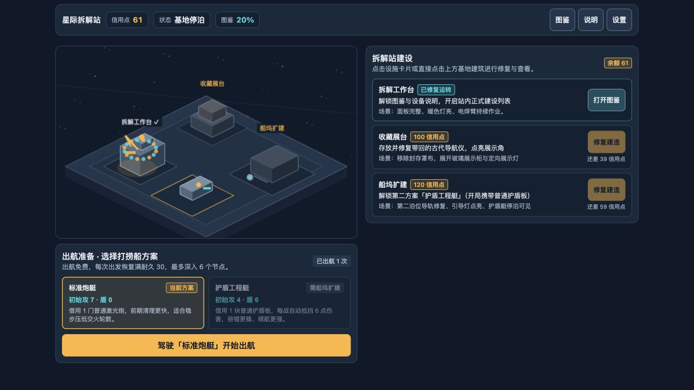

# 星际拆解站：策划与美术符合性检查报告

检查日期：2026-11-21（新加坡时间）

审查版本：`490d8bcd21c5bbe5bc55615a928b378be3de5417`

检查对象：本地运行版本，未修改源码、未推送变更。

## 1. 结论

**当前版本可以作为功能原型继续开发，但不应按“策划与美术要求全部完成的首版”验收。**

已经有可玩的船舱拼装、自动战斗、奖励选择、返航与基地建设闭环。点选放置、旋转、电池邻接、正常结算、失败折算和常规读档都有本次实际运行证据。

主要差距有三类：

1. **可靠性与输入隔离不完整：** 弹层内快捷键能修改背后布局；只读标签页仍可操作但不保存；结构损坏的存档可能绕过备份恢复。
2. **关键体验尚未落实：** 教学第三站没有制造文档要求的空间取舍，手机布局需要较多滚动，回港缺少卸货与进港表现。
3. **视觉完成度不足：** 基地主要由简单几何体组成，机械细节、材质与生活活动不足；重要小字和网格边界也未满足明确的尺寸/对比度目标。

共记录 **13 项发现：12 项已确认缺陷/偏差，1 项响应式异常待稳定性复验；优先级为 P1 5 项、P2 7 项、P3 1 项**。本轮常规试玩未发现阻断首局的 P0；这不代表所有边界均无阻断问题。

优先级口径：P1 为影响进度可靠性、核心体验或成品验收的事项；P2 为应在正式发布前修复的交互/视觉/流程问题；P3 为较低影响但应统一口径的偏差。美术 P1 表示不能通过美术成品验收，不表示程序无法启动。

## 2. 依据、方法与限制

### 验收依据

- 仓库内《游戏策划与实施蓝图》v0.2，以下简称“策划”。
- 仓库内《美术制作与验收规范》v1.0，以下简称“美术”。
- [Web Interface Guidelines](https://raw.githubusercontent.com/vercel-labs/web-interface-guidelines/main/command.md)，仅辅助检查焦点、键盘及弹层交互，不替代本项目要求。
- 代码证据均固定到本次 [审查提交](https://github.com/GOD-OF-PPT/starline/commit/490d8bcd21c5bbe5bc55615a928b378be3de5417)。

### 实际执行

| 检查 | 本次证据 |
|---|---|
| 独立试玩 | 使用 `127.0.0.1:5175`；用户原来的 `5174` 存档与服务未改动 |
| 第一趟 | 教学普通线 1–3 节点，炮/电池/旧引擎，安全返航，修复工作台，刷新读档 |
| 第二趟 | 正式航次，L 形设备放置与舍弃，危险线奖励、T 形收藏物，第三站主动进入已提示必败的路线，验证失败结算 |
| 输入 | 点选放置、旋转、舍弃撤销、弹层快捷键隔离、倍速、快速结算 |
| 可靠性 | 战斗中刷新、建设后刷新、多标签页只读、低动效/低画质设置保存 |
| 响应式 | 360×640、390×844、430×932、844×390、1366×768 CSS 像素；初始桌面还取证 1280×720 |
| 自动化 | 原有 2 个测试文件共 16 项通过；另做结构损坏存档检查和策略通关分布补查 |
| 视觉证据 | 保存 23 张截图；布局测量见 `responsive-metrics.json` |

浏览器检查使用桌面内置浏览器的视口模拟，采样 DPR 为 1；没有冒充 iPhone/Android 真机验证。未进行实际触屏拖拽、音频听感、长时间帧率/显存、真实玩家回访或跨浏览器兼容测试。六层通关有规则模拟证据，未在本轮浏览器中完整手动通关六层；高级藏品安全带回并修复的 UI 全链路也未实测。

## 3. 符合性概览

| 要求 | 结论 | 依据 |
|---|---|---|
| 4×4 船舱，点选、旋转、暂存 | 本轮样例通过 | 炮旋转后重新排布；L/T 形物品成功入舱 |
| 电池正交邻接，一电池多炮 | 本轮样例通过 | 攻击 10→14，两个炮分别获得 +2；舍弃后回到 10，撤销后回到 14 |
| 预览与同步战斗一致 | 本轮样例通过 | 教学三战耐久 30→26→22→16；第二战刷新重放仍为 22 |
| 安全返航与基地建设 | 本轮样例通过 | 25 悬赏+8 炮+6 电池+47 引擎+15 教学补贴=101；建工作台后 61，刷新仍为 61 |
| 失败保留 40%，发现/实物分离 | 本轮样例通过 | 18 悬赏+78 导航仪=96，失败获得 floor(96×0.4)=38；图鉴显示已发现但未带回实物 |
| 舍弃离开前统一确认 | 不符合 | F09 |
| 多标签页只读 | 部分实现，有缺陷 | F02 |
| 结构损坏存档恢复 | 不符合 | F03 |
| 第三站空间取舍教学 | 不符合 | F05 |
| 工业科幻方向、色板与视角分工 | 部分符合 | 深色工业色板、轴测基地、正交船舱已具备；精细程度不足 |
| 成品美术、返航演出 | 不符合 | F04、F11 |
| 小屏与旋转屏适配 | 部分符合 | 无页面横向溢出样例，但重要操作超出视口且场景缩放异常，F06、F07 |
| 字号、网格对比度 | 不符合 | F08 |
| 键盘完整操作与弹层边界 | 不符合 | F01、F10 |
| 低动效/低画质 | 部分验证 | 开关与刷新保存正常；全部特效状态仍需专项覆盖 |
| 包体、性能、真实留存 | 暂不验收 | 缺真机与长期样本，不能由构建成功推断 |

## 4. 优先处理的缺陷

### F01 · P1 · 规则弹层没有隔离船舱快捷键

**性质：浏览器已复现。**

- 要求：策划 §9 明确输入与游戏状态边界；弹层操作不能影响背景玩法。
- 复现：整理阶段选中一门竖向炮 → 打开“规则说明” → 将焦点置于弹层“关闭”按钮并按 `R`。
- 实际：弹层仍显示，但背景炮从 0° 变成 90°，会进入正常布局更新与保存逻辑。按 Escape 也没有关闭弹层，而是清除背景物品选择。
- 影响：阅读规则或键盘操作弹层时可能无意修改布局；修改可能改变邻接、战力与后续生存结果。
- 定位：[CargoGrid.ts:747](https://github.com/GOD-OF-PPT/starline/blob/490d8bcd21c5bbe5bc55615a928b378be3de5417/src/ui/CargoGrid.ts#L747)、[Modals.ts:12](https://github.com/GOD-OF-PPT/starline/blob/490d8bcd21c5bbe5bc55615a928b378be3de5417/src/ui/Modals.ts#L12)。全局键盘处理只排除了输入框，未检查弹层；弹层缺少焦点圈定。
- 修复：统一管理输入模式；弹层打开时暂停背景布局动作，并设置对话框语义、焦点进入/回归、Tab 圈定和 Escape 关闭。
- 验收：规则、设置、图鉴打开时，R/方向键/Enter 均不能变更船舱；关闭后焦点回到来源按钮，背景快捷键才恢复。

证据：[弹层截图](screenshots/10-modal-input-leak.jpg)。截图记录弹层状态；旋转变化另由 DOM 样式从 `rotate(0deg)` 变为 `rotate(90deg)` 确认。

### F02 · P1 · “只读模式”仍允许游玩，刷新后丢失本页操作

**性质：浏览器已复现。**

- 要求：策划 §9 多标签页只读/接管保护；界面状态应真实表达是否可操作。
- 复现：主标签停留在基地 → 打开同地址第二标签 → 不接管，直接点击“开始出航” → 刷新第二标签。
- 实际：第二标签显示“只读模式”，但仍能进入节点 1；刷新又回到基地，刚才出航状态消失。
- 影响：玩家可以继续投入操作，却得不到持久化结果。已阻止写入冲突，但没有实现真正的只读体验。
- 定位：[AppController.ts:206](https://github.com/GOD-OF-PPT/starline/blob/490d8bcd21c5bbe5bc55615a928b378be3de5417/src/ui/AppController.ts#L206)、[AppController.ts:346](https://github.com/GOD-OF-PPT/starline/blob/490d8bcd21c5bbe5bc55615a928b378be3de5417/src/ui/AppController.ts#L346)。仅 `persist()` 拒绝写入，出航和其他状态变更入口未统一拒绝。
- 修复：在动作分发层校验写权限；只读页面禁用出航、奖励、建设、拼装与结算，保留查看与接管。失去控制权时暂停战斗推进，接管后加载最新存档。
- 验收：只读页所有变更动作均不可执行；接管后才可操作；刷新不会出现已经玩过但消失的未告知进度。

证据：[只读但已经进入航次](screenshots/13-readonly-still-playable.jpg)。

### F03 · P1 · 存档结构校验过浅，损坏航次绕过有效备份

**性质：独立规则运行已复现；未破坏真实浏览器存档。**

- 要求：策划 §9、§11 要求损坏存档提供备份恢复，并验证存档版本与完整状态。
- 复现：基于正常存档，令 `activeExpedition={phase:'ARRANGE',currentNode:2}`，同时提供完整有效备份；调用加载函数，再进入船舱属性计算。
- 实际：加载结果为 `loaded`；随后的规则依赖报错 `Cannot read properties of undefined (reading 'placed')`，没有选择备份。
- 影响：部分字段丢失、迁移错误等语义损坏可能使加载流程崩溃；JSON 能解析不代表存档可用。
- 定位：[persistence.ts:51](https://github.com/GOD-OF-PPT/starline/blob/490d8bcd21c5bbe5bc55615a928b378be3de5417/src/domain/persistence.ts#L51)。未完整校验 activeExpedition、阶段必需字段、物品定义、坐标与嵌套数组。
- 修复：完整 schema 校验＋明确版本迁移；校验阶段与字段组合、有限数值、物品 ID、坐标/旋转、种子游标和去重 ID。只有验证通过的快照才可成为备份。
- 验收：有效 JSON 但缺 bay、非法 phase、未知物品、越界节点等均进入恢复分支；有效备份存在时不得直接加载坏档。

证据：[独立检查输出](persistence-check.json)。

### F04 · P1 · 基地视觉仍是几何原型，未达到精致工业科幻成品要求

**性质：截图与代码对照的美术验收判断。**

- 要求：美术 §2、§5、§9 要求可辨机械结构、材质层次、局部维护痕迹、工作生活活动；成品验收看实际页面。
- 实际：基地由大菱形平台和少量方盒主导。工作台升级确有新灯、机械臂和施工点状特效，但缺少足够清晰的工作区构造、工具墙、功能部件与表面层次；收藏展台与泊位主要靠标签解释身份。
- 影响：经营成长缺乏足够有吸引力的视觉成果，整体更接近布局样机。设备 SVG 的辨识度好于基地，但两个层面的完成度不一致。
- 定位：[BaseScene.ts:357](https://github.com/GOD-OF-PPT/starline/blob/490d8bcd21c5bbe5bc55615a928b378be3de5417/src/scenes/BaseScene.ts#L357)、[BaseScene.ts:427](https://github.com/GOD-OF-PPT/starline/blob/490d8bcd21c5bbe5bc55615a928b378be3de5417/src/scenes/BaseScene.ts#L427)。问题是最终画面信息和工艺不足，不是“程序绘制”这种方法本身错误。
- 修复：先完成一个工作台的破旧/修复成品样板；补清楚的台面、机械臂关节、工具架、导轨、材质面与接触阴影，再扩展到船坞和展台。保持原锚点与占地，不用堆粒子替代结构。
- 验收：手机实际尺寸下，不看名称也能区分三种建筑用途；升级前后至少两项结构/灯光/活动变化清楚可见；与同屏舰船、物品的细节密度协调。

### F05 · P1 · 教学提示“空间紧张”，实际没有体验到关键取舍

**性质：浏览器已复现，配置可解释。**

- 要求：策划 §3 明确第三次整理制造“货物与设备装不下”的选择。
- 复现：第一站选炮，第二站选电池，第三站选旧引擎；按有效位置摆入。
- 实际：占用从 2→4→5→9 格，旧引擎顺利放下，仍有 7 格空位。提示却说“舱格开始紧张了：是扔掉旧货装装备，还是见好就收？”
- 影响：第一趟教学没有兑现游戏最重要的卖点——空间迫使赚钱与生存发生冲突。教程文字替代了实际体验。
- 定位：[tutorial.ts:32](https://github.com/GOD-OF-PPT/starline/blob/490d8bcd21c5bbe5bc55615a928b378be3de5417/src/data/tutorial.ts#L32)。没有对应的空间压力配置。
- 修复：制作独立、公开的教学局面，在第三站前形成可整理解决或需舍弃解决的真实冲突，并确保返航资金仍足够。先确定教学盘面，不直接改正式航次容量或暗改掉率。
- 验收：测试者必须实际遇到至少一次“全部带走不可行”的局面，并可选择保货返航或让出空间强化；不能仅用提示文字算完成。

证据：[第三站完整页面，显示 9/16 格](screenshots/09-tutorial-space-pressure-full.jpg)。

## 5. 其余缺陷与明确偏差

### F06 · P2 · 手机与短横屏的船舱、操作和返航信息相距过远

- 要求：策划 §8、美术 §6/§8 要优先保护船舱与关键操作，短屏先收起次要内容。
- 实际：360×640 整理页中，船舱从页面 y≈494 开始，底部到 y≈796；返航按钮位于 y≈1105。844×390 横屏中，返航按钮在 y≈511，船舱底部约 y≈618。两种情况下首屏均看不全核心操作。390px 手机的航路页总高达到 1616px。
- 影响：玩家要反复在物品、战力和下一战预测之间滚动；全局 HUD 和教学文案换行占去大量高度。手动“收起舰船”可缓解，但默认状态仍不满足短屏优先规则。
- 定位：[styles.css:281](https://github.com/GOD-OF-PPT/starline/blob/490d8bcd21c5bbe5bc55615a928b378be3de5417/src/ui/styles.css#L281)、[styles.css:1157](https://github.com/GOD-OF-PPT/starline/blob/490d8bcd21c5bbe5bc55615a928b378be3de5417/src/ui/styles.css#L1157)。当前主要是长页面重排，缺少高度感知的紧凑布局；844×390 也未命中限定宽度 ≤819 的短屏规则。
- 修复：整理页短屏默认折叠展示场景；HUD 压成两行以内；底部保留不遮挡棋盘的决策区；物品详情作为按需展开内容。航路比较压缩成并列关键指标。
- 验收：上述两种尺寸至少能在一个操作视野中查看完整棋盘和明确的下一步入口；旋转、放置与返航无需连续来回滚动。

证据：[360×640 截图](screenshots/arrange-360x640.jpg)、[布局数据](responsive-metrics.json)。

### F07 · P2 · 视口变化后出现裁切/旧画布尺寸，持续性待复验

- 要求：美术 §15 检查多尺寸与旋转，场景不裁切、不跳位。
- 复现：桌面基地加载后切换到 390×844 手机视口；另在整理页连续切换不同视口。
- 实际：首次切换的基地右侧、下侧被裁切；重新加载后同尺寸可以正确显示。整理页测量也出现 canvas 仍保持上一尺寸的现象，例如 360px 视口下 canvas 宽 356、右边界 373，超出可用区域。
- 影响：浏览器缩放/横竖屏切换可能看不到部分建筑或舰船。**该现象发生在视口变更取证路径，不应描述成所有手机首次打开都裁切。** 本轮未量化异常持续时间，不能排除工具快速切换捕捉到布局过渡帧；在真机和稳定后的截图复现前，不将其算作已确认的持久性缺陷。
- 定位：[PhaserHost.ts:109](https://github.com/GOD-OF-PPT/starline/blob/490d8bcd21c5bbe5bc55615a928b378be3de5417/src/scenes/PhaserHost.ts#L109)、[AppController.ts:136](https://github.com/GOD-OF-PPT/starline/blob/490d8bcd21c5bbe5bc55615a928b378be3de5417/src/ui/AppController.ts#L136)。需检查容器布局完成时间、Scale.RESIZE 与手动 resize 的重复职责、场景摄像机 viewport 同步。
- 复验与修复：先在布局稳定后和真实旋转设备上重测；若仍异常，再以实际容器 ResizeObserver 驱动统一尺寸更新，布局完成后同步 canvas、摄像机与场景坐标，避免使用变化前的宽高。
- 验收：连续桌面→手机→横屏→桌面切换，无需刷新即可完整显示；记录稳定后的 canvas/host 尺寸一致。

证据：[切换后裁切](screenshots/02-base-mobile.jpg)、[同尺寸刷新后正常](screenshots/14-base-mobile-fresh.jpg)。

### F08 · P2 · 关键小字和船舱格线低于明确美术标准

- 要求：美术 §4 必要格子边界对比度目标 ≥3:1，§8 次要标注至少 12px。
- 实际：设备攻值、货物价格、借用标记、格数、电池增益等多处为 11px。格线 `#2b3c52` 对叠加后的格子背景约 **1.42:1**。
- 影响：小屏辨认成本高，空格边界偏弱；这些信息直接服务空间拼装，不能按纯装饰处理。
- 定位：[styles.css:712](https://github.com/GOD-OF-PPT/starline/blob/490d8bcd21c5bbe5bc55615a928b378be3de5417/src/ui/styles.css#L712)、[styles.css:742](https://github.com/GOD-OF-PPT/starline/blob/490d8bcd21c5bbe5bc55615a928b378be3de5417/src/ui/styles.css#L742)、[styles.css:855](https://github.com/GOD-OF-PPT/starline/blob/490d8bcd21c5bbe5bc55615a928b378be3de5417/src/ui/styles.css#L855)。
- 修复：功能标注至少 12px，关键数字优先 14px；提高格线/交点可辨度，减少重复边框和多层卡片，把对比度留给有效信息。
- 验收：实际 360px 宽、灰度截图均能辨认格线与数值；重新计算最终合成色对比度。

证据：[对比度计算](contrast-check.json)、`responsive-metrics.json` 中的实际计算字号。

### F09 · P2 · 离开整理阶段未确认舍弃清单

- 要求：策划 §4 明确“离开时统一确认舍弃清单”。
- 复现：正式首站取得并放入维修无人机 → 舍弃 → 出现“撤销舍弃(1)” → 点击继续深入。
- 实际：直接进入下一站，无清单确认，撤销窗口同时结束。
- 影响：误舍弃物品可能在一次无提示跳转后永久丢失；阶段内撤销已实现，但缺少文档要求的最后检查。
- 定位：[AppController.ts:1100](https://github.com/GOD-OF-PPT/starline/blob/490d8bcd21c5bbe5bc55615a928b378be3de5417/src/ui/AppController.ts#L1100)、[expedition.ts:378](https://github.com/GOD-OF-PPT/starline/blob/490d8bcd21c5bbe5bc55615a928b378be3de5417/src/domain/expedition.ts#L378)。
- 修复：仅当存在待提交舍弃项时展示物品名、数量和估值；允许返回整理或确认。无舍弃项不增加额外弹窗。
- 验收：继续与返航两个出口都覆盖，取消后仍能撤销，确认后才提交舍弃。

证据：[离开后直接进入节点 2](screenshots/16-discard-no-confirm.jpg)。

### F10 · P2 · 船舱没有完整键盘操作路径

- 要求：策划 §9 输入支持键盘和触控；辅助界面规范要求手势有键盘替代路径。
- 实际：棋盘虽有 `role=grid`，格子和暂存物品没有对应的可聚焦语义、方向键移动或 Enter 放置逻辑。全局键盘仅处理已选中物品的 R/Escape；纯键盘无法完成选物品→选格子→放置。
- 影响：不能依赖键盘完成核心玩法；添加一个 grid 角色不等于可访问操作。
- 定位：[CargoGrid.ts:168](https://github.com/GOD-OF-PPT/starline/blob/490d8bcd21c5bbe5bc55615a928b378be3de5417/src/ui/CargoGrid.ts#L168)、[CargoGrid.ts:461](https://github.com/GOD-OF-PPT/starline/blob/490d8bcd21c5bbe5bc55615a928b378be3de5417/src/ui/CargoGrid.ts#L461)、[CargoGrid.ts:747](https://github.com/GOD-OF-PPT/starline/blob/490d8bcd21c5bbe5bc55615a928b378be3de5417/src/ui/CargoGrid.ts#L747)。
- 修复：为暂存与棋盘建立可聚焦选择、roving tabindex、方向键候选格、Enter 确认、Escape 取消和明确的无效落点反馈。
- 验收：只用键盘完成一次奖励入舱、旋转、移动和返航；焦点始终可见且不穿透弹层。

### F11 · P2 · 返航缺少文档要求的进港、卸货和收益汇入表现

- 要求：策划 §8、美术 §10 要求拖船进港、货物卸下、收益汇入，默认演出 ≤1.5 秒且可跳过。
- 实际：点击返航后直接显示文本结算，再确认入账切回基地；有音效调用，但没有对应的进港与卸货画面阶段。
- 影响：一局中最重要的兑现时刻缺乏与风险相称的视觉反馈，基地成长与出航收益衔接生硬。
- 定位：[AppController.ts:1100](https://github.com/GOD-OF-PPT/starline/blob/490d8bcd21c5bbe5bc55615a928b378be3de5417/src/ui/AppController.ts#L1100)、[AppController.ts:1256](https://github.com/GOD-OF-PPT/starline/blob/490d8bcd21c5bbe5bc55615a928b378be3de5417/src/ui/AppController.ts#L1256)。
- 修复：增加只消费已确定结算结果的短演出，不让演出回调拥有发钱权限；表现船进泊位、货物卸载和余额变化，支持跳过/低动效。
- 验收：完整播放、跳过、刷新恢复都只入账一次；低动效仍清楚呈现收益和建设目标进度。

### F12 · P2 · 失败结算页顶部仍显示未折算的“预计返航”金额

- 要求：策划 §5 和美术 §8 关键收益信息须准确且优先。
- 复现：带着 78 点导航仪与 18 点悬赏战败。
- 实际：结算正文正确显示实得 38，但顶部持续显示“预计返航 +96”，两处口径冲突。窄屏下正文实得还可能位于较下方。
- 影响：玩家可能误认为本次可获得 96，或对折算产生疑问。
- 定位：[AppController.ts:265](https://github.com/GOD-OF-PPT/starline/blob/490d8bcd21c5bbe5bc55615a928b378be3de5417/src/ui/AppController.ts#L265)。HUD 一律用悬赏加船舱原值，没有随结算状态切换。
- 修复：结算阶段显示“本次实得 +38”；安全返航也使用同一结算摘要，考虑保留收藏和教学补贴。
- 验收：HUD、结算总额、最终余额增量一致；不把折算前估值标成可兑现收益。

证据：[失败结算完整页面](screenshots/18-defeat-settlement.jpg)。

### F13 · P3 · 第六节点整理结束后的返航仍为手动触发

- 要求：策划 §2 规定第六节点奖励整理后自动返航。
- 实际：代码在最终节点显示“满载返航·结算”按钮，由玩家点击才转入结算；没有第七节点越界问题。
- 性质：代码可确认的流程差异，未在本轮浏览器手动通关中复现。
- 定位：[AppController.ts:1050](https://github.com/GOD-OF-PPT/starline/blob/490d8bcd21c5bbe5bc55615a928b378be3de5417/src/ui/AppController.ts#L1050)、[AppController.ts:1077](https://github.com/GOD-OF-PPT/starline/blob/490d8bcd21c5bbe5bc55615a928b378be3de5417/src/ui/AppController.ts#L1077)。
- 建议：在“完成整理”明确确认之后自动进入返航，避免物品刚放下就强行抢走整理权；若产品决定保留手动结算，应更新策划，而非默认为完全符合。
- 验收：策划、按钮文案与状态机一致；末站不能开始第七战，也不能漏发或重复发奖励。

## 6. 可玩性与平衡：证据不足的部分单独列出

本轮原有测试全部通过，但其结论比产品验收范围窄。

原模拟为 2 种开局×6 类策略×80 种种子，共 960 次规则运行。所有策略都会在下一普通节点预测必败时提前返航，因此打印出来的 `safeRate=1` 主要反映这一保护策略，**不能解释成真人成功率 100%、难度适宜或没有风险**。[simulation.test.ts:199](https://github.com/GOD-OF-PPT/starline/blob/490d8bcd21c5bbe5bc55615a928b378be3de5417/tests/simulation.test.ts#L199)

为补齐“平均深度掩盖通关分布”的信息，本轮复用相同策略与种子做额外统计：

| 开局 | 策略 | 完成六层 / 80 | 平均信用点 |
|---|---|---:|---:|
| 炮艇 | 只运货 | 0 | 71.48 |
| 炮艇 | 堆炮 | 0 | 77.30 |
| 炮艇 | 盾炮混合 | 4 | 89.81 |
| 炮艇 | 维修续航 | 4 | 84.54 |
| 炮艇 | 保守三层返航 | 0 | 88.19 |
| 炮艇 | 深入策略 | 3 | 69.26 |
| 护盾艇 | 只运货 | 0 | 105.63 |
| 护盾艇 | 堆炮 | 4 | 86.33 |
| 护盾艇 | 盾炮混合 | 7 | 86.44 |
| 护盾艇 | 维修续航 | 6 | 99.68 |
| 护盾艇 | 保守三层返航 | 0 | 88.19 |
| 护盾艇 | 深入策略 | 2 | 67.78 |

这些都是既定启发式策略的结果，不是最优策略搜索，也不是玩家数据。炮艇有三类策略出现六层通关，所以不能说“六层无法完成”；但保守三层返航约 88.19、盾炮混合约 89.81 的每局收入差距很小，**值得进一步验证深入的时间成本是否划算**。当前未测每分钟收益，不能直接宣布保守路线必然最优。

### 优化建议与验证方式

| 优化方向 | 具体改法 | 是否已认定为缺陷 | 判断标准 |
|---|---|---|---|
| 增强空间取舍 | 先修教学盘面，再记录正式局发生第一次替换/舍弃的节点 | 教学已是 F05；正式局频率仍待验证 | 玩家是否因空间主动改变计划，而不是无脑放入 |
| 提高深入吸引力 | 调整深层独有收藏、货物价值或构筑机会；一次只改一个变量 | 优化假设 | 同时比较每分钟收入、六层率、收藏获取率 |
| 让构筑结果更直观 | 战前显示本次摆放节省的交火轮数与耐久，炮/电池连接有局部反馈 | 已有基础，可加强 | 不看长说明也能说出为何布局更强 |
| 缩短重复阅读 | 战斗/奖励/整理复用紧凑状态栏，详情按需展开 | F06 的体验扩展 | 不降低信息准确性的前提下减少滚动与重复点击 |
| 经营反馈 | 展示下个建筑还差多少及本趟贡献，升级体现真实作业活动 | 与 F04/F11 相关 | 玩家能直观看出“这趟回来建成了什么” |
| 价值与品质分工 | 保持两档品质，货物高价用报价表达 | 基础实现已存在 | 玩家不把高价货当成强装备 |

不建议此时增加新货币、挂机计时、复杂词条或更多设施；它们无法修复现有输入错误，也不能替代空间博弈和成品画面。

## 7. 建议修复顺序与复验门槛

### 第一批：先修进度与输入安全

处理 F01、F02、F03、F09、F12。每项配能够复现真实边界的检查，不能只测内部函数的正常分支。

完成条件：弹层不改背景局面；只读页不产生可游玩的未保存进度；语义坏档恢复备份；舍弃提交有清单；结算金额各处一致。

### 第二批：恢复首局和手机体验

处理 F05、F06、F07、F08、F10、F13。

完成条件：第三站实际产生取舍；全部规定视口重测；横竖屏切换不依赖刷新；键盘可完成入舱；字号/格线达到文档目标。

### 第三批：完成一屏成品美术，再批量制作

处理 F04、F11。先以“工作台修复前后＋船舱整理＋短返航”形成可实际操作的样板，再扩展全部资产。

完成条件：实际手机尺寸能识别建筑功能和材质，变化不靠文字解释；返航与建设有短、可跳过、不会重复结算的反馈。

### 第四批：真正验收平衡和性能

- 补 UI 全链路：两种舰船、完整六层、导航仪安全保留/出售/修复、满仓替换、长期连续十局。
- 补真实设备：iOS Safari、Android Chrome、桌面浏览器；实际触屏拖拽、后台恢复、安全区、高 DPR 与低性能机器。
- 测首屏网络体积、启动耗时、帧时间分布、峰值纹理内存；不得以“构建包较小”替代运行性能。
- 按策划找 8–12 位未读过说明的玩家，记录首次取舍、误操作、自发第二局与失败归因。AI 试玩不计入这批玩家样本。

## 8. 附件与交付说明

- `screenshots/`：23 张原始截图，包含桌面、手机、弹层、只读、返航、战败与图鉴。
- `responsive-metrics.json`：实际视口、页面高度、棋盘/按钮位置与字号。
- `contrast-check.json`：格线对比度计算输入与结果。
- `persistence-check.json`：结构损坏存档的独立运行结果。
- `strategy-results.json`：复用既有策略与种子的六层通关分布。
- `复现摘要.md`：主要浏览器操作与观察结果，供后续开发复验。

本报告未修改游戏实现、未替用户调整策划、未提交 GitHub issue、未推送仓库。测试用页面已关闭，视口覆盖已恢复，用户原来的本地服务保持可用。
