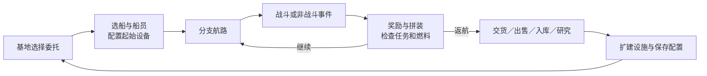

# 星际拆解站 V2：远航经营

完整游戏策划案 · 设计版本 2.0-draft.1 · 2026-11-21

## 0. 文档定位与需求来源

用户在仔细试玩后反馈：“这个游戏的玩法特别单薄”，随后要求将玩法深化建议形成完整策划案。V2 的任务是增加能改变后续局面的选择，使拼装、航行和经营互相影响；不是仅提高美术完成度或增加装备数量。

本案是新的可实施设计提案，不代表用户已经逐条批准数值，也不代表已经实现或验证好玩。所有战斗、售价、时长和增长数值均为原型起点。

实施参考现有修复分支代码：`0d92e49`。继续使用既有 TypeScript/Vite/Phaser 结构、占格操作和工业科幻视觉。不得把外部修复报告中的“通过”直接当作 V2 验收证据。

优先关系：本案明确替换的玩法以本案为准；其他素材、色板、透明掩码、输入、可靠性、低动效与资源管理规则沿用《美术制作与验收规范》v1.0。旧策划保留为历史依据，不静默覆盖。

### V2 具体替换什么

| V1 | V2 |
|---|---|
| 六次顺序战斗，每次普通/危险二选一 | 六层分支航路，战斗、废船、商人、异常区、求救事件混合 |
| 通用赚钱目标 | 出航前选择一个委托，每个委托改变物品与航路价值 |
| 攻击汇总＋电池邻接 | 独立装备触发、目标类型、三种可辨识组合 |
| 每趟从固定小炮起步 | 永久蓝图、舰船、船员和有限开局配置；途中装备可以带回保存 |
| 设备默认全部出售 | 安全返航选择出售或入库；入库后可研究，每件只结算一次 |
| 30 耐久、无出航补给 | 舰船不同耐久，新增本趟燃料；无离线等待 |
| 两档装备品质 | 完整 V2 仍最多两档；玩法原型只用普通品质 |
| 失败损失大部分现金，初始设备无价值 | 借用设备仍无价值；自带库存设备和本趟拾获物承担明确风险 |

## 1. 产品定位

**一句话：经营一座太空打捞站，为每趟委托设计一艘船，在航路上发现机会、调整装备，最后决定带什么回家。**

- 平台：移动端竖屏网页优先，兼容桌面鼠标和键盘。
- 受众：喜欢轻策略、空间整理、收集建设，希望有思考但不想练手速的玩家。
- 单趟目标：6–10 分钟，可在稳定节点保存退出；单场战斗目标 8–20 秒，支持加速与跳过。
- 核心操作：点选/拖放、旋转、选路线、选事件方案、确认返航。
- 首发模式：离线单人，无账号需求，无体力倒计时，无日常打卡，无付费能力。
- 体验目标：第一次能玩，第三次会换计划，第十次还会因路线和掉落重新思考。

### 三条产品支柱

1. **带着任务出发。** 出航之前就有计划，不是进局后只看哪个数字大。
2. **计划允许改变。** 途中发现的新机会值得绕路、换装或提前回家。
3. **带回来的东西改变下一局。** 钱、设备、蓝图、收藏各有作用，但不增加一堆资源货币。

### 三个核心决定

- 空间：保留任务货，还是装新设备改善生存？
- 路线：走目标方向，还是绕去商人/废船获得构筑关键件？
- 回港：兑现已有成果，还是争取下一层的奖励和任务尾款？

## 2. 典型的一趟旅程

玩家接下“回收反应堆”，看见任务物占 2×3 格，选货船并预留空间。第二层遇到商人，发现防空阵列，能克制通向反应堆的蜂群；买下它会暂时占用任务货所需空间。玩家先安装，打赢蜂群后将旧炮移入暂存、重排装备，腾出六格装反应堆。

第五层可选撤离前最后一次探索：左边维修港能稳妥带货回家，右边废船有未研究的无人机设备，但会多消耗燃料。玩家这次返航交货，下次带工程船来寻找那类设备。

同样的操作可以服务不同目的：挣钱、完成委托、研究打法、修收藏。故事来自公开规则下的选择，不靠随机突然判死。

## 3. 首发内容边界

完整 V2 首发内容固定为：

| 内容 | 数量与边界 |
|---|---|
| 委托 | 3 种机制，每种 2 个数据变体，共 6 份模板 |
| 航路 | 1 个星域，6 层、每层 2 个节点；3 种环境外观共用规则 |
| 非战斗节点 | 废船打捞、流动商人、异常区、求救信号 4 类 |
| 战斗 | 4 类普通遭遇＋1 个末层精英；参数随深度分档 |
| 设备 | 10 类；先做普通，再做优良，不加入随机词条 |
| 舰船 | 3 艘，空间/耐久/装配预算不同 |
| 船员 | 3 名，每趟选 1 名，技能固定无随机养成 |
| 普通货物 | 沿用 6 种，另加 2 种专属任务货 |
| 收藏 | 先保留古代导航仪 1 件，增加收藏不作为首发深度指标 |
| 基地设施 | 5 类：工作台、船坞、收藏展台、委托中心、研究台 |

不做：多人、赛季、装备强化到几十级、复杂元素反应、实时瞄准、人员受伤计时、交易所、随机永久丢失蓝图。

此前举例的“捕获敌方无人机”暂不进入首发：它需要独立的捕获与控制胜利条件。首发用运输、救援、勘测三种机制先证明差异，不用半完成的捕获系统凑数量。

## 4. 委托系统：让每趟有明确目标

### 4.1 接取与完成

- 每趟只能接 1 个委托，也可选择自由打捞。
- 看清目标、任务货占格、奖励、目标深度、保证提供的目标机会后再接。
- 接取不收费用；失败/主动放弃不倒扣基地信用点，不影响下次接取。
- 出航开始后不能换委托；可以提前回港或舍弃任务物，正常结算其他收入。
- 委托奖励只在安全返航、满足完整条件且完成交付时支付一次。无战败任务奖励。
- 首发不使用现实时间限时。目标压力来自航线、燃料和空间。

### 4.2 三类委托的精确规则

| 类型 | 标准档 | 深入档 | 为什么玩法不同 |
|---|---|---|---|
| 大件运输 | 第 3 层回收密封反应堆；2×3 六格；返航耐久至少 1；报酬 70 | 第 5 层回收同尺寸反应堆；报酬 120 | 提前预留连续空间，取得后可能舍弃设备或提前撤离 |
| 失联救援 | 第 3 层救出工程师，救生舱 1×2；带回 70 | 第 5 层救出两人，两个 1×2 救生舱；带回 120 | 占格较小，但携带救生舱后每次出发多耗 1 燃料，无论一舱或两舱 |
| 航迹勘测 | 指定三处标记节点中完成任意两处；每次消耗 1 燃料；带回两份记录 70 | 第 2、4、6 层各一处，全部完成；报酬 120 | 不占货舱，但路线与燃料受限制，不能只挑最赚钱的支路 |

初始仅展示标准档运输、救援和勘测；深入档在完成任一标准委托并到达过第 4 层后开放。每次委托板展示三种类型各一份符合解锁条件的模板，不把三项都随机成同一类型。

运输任务货无独立耐久、不会随机爆炸、无普通卖价。救生舱不能出售或研究；玩家选择中止救援时由救援信标转交，任务失败并移除救生舱，不描绘为抛弃人员。勘测记录是任务状态，不是可出售物品。

任务目标节点以地图标签标明，进入并成功完成节点后才能领取任务货/执行勘测。奖励与任务物分开：任务物必须处理暂存，节点常规奖励仍可取得。勘测每节点只能执行一次。

### 4.3 防止不可完成

航路生成必须保证至少一条连通路线覆盖全部必要目标。目标可以有公开战斗门槛，但不能被随机生成成地图上不存在、不可达或目标货形状超出舰船容量。

对救援保证目标之后存在无需再推进节点即可呼叫返航的机会；勘测保底路线的总燃料成本不得超过开局燃料。玩家主动绕路可以使任务失败，但生成器不能让玩家在出发前已经必败。

## 5. 航路与事件

### 5.1 六层有向图

- 每层两个节点 A/B，玩家访问其中一个；所有边只连接下一层，不回头、不刷同一事件。
- 起点连接第一层两个节点；每个节点至少有一条出边；两条出边优先保留，但不必所有节点完全连通。
- 生成顺序：先放委托目标与可达保底路线，再放事件与可选战斗，最后填奖励。
- 第 1 层固定提供一个废船打捞节点和一个轻战斗节点。
- 六层中至少有 2 层提供非战斗选项；至少一个商人在第 2–4 层的可达路径；最多连续 2 层强制战斗。
- 第 6 层提供精英战和非战斗终点两种选择；精英不是所有委托的强制门槛。完成末层整理后返航。
- 选定边、扣燃料、确定事件状态必须一次提交。刷新不重抽节点、商店库存或事件内容。

### 5.2 信息披露

完整地图显示：节点类型、连接关系、深度、委托标记、特殊消耗和奖励类别。未到达节点的具体货物可未知；临近可进入节点显示敌人组成、行为与准确战斗预览。

当前节点内所有不可逆选项必须先列出代价与已知收益；没有“点了才知道扣耐久”的隐藏惩罚。神秘感放在探索产物，不隐藏规则或伪造概率。

### 5.3 燃料与返航

- 每次出航燃料 9，上限 10，所有船相同。基地免费补满；不随现实时间恢复。
- 从起点进入首层、从已完成节点进入下一层，基础各耗 1 燃料。
- 救生舱携带时，每次新边额外耗 1；多个救生舱仍只加 1。
- 勘测额外耗 1；异常区和事件的额外成本见事件方案。
- 不足以支付完整成本时禁止出发，明确显示差额；不存在负燃料。
- 每个已解决节点都可通过回收信标免费安全返航，返航不消耗燃料。燃料为零不自动失败，整理后只能返航或在当前事件仍有合法补给选项时补给。
- 战斗失败执行拖回结算；战斗开始后不能中途安全撤退。

燃料控制探索机会，不成为反复购买的第二种永久货币。

### 5.4 四类非战斗节点

| 节点 | 选项与规则 | 限制 |
|---|---|---|
| 废船打捞 | 从武器舱、货仓二选一；武器舱给 1 件设备，货仓给 2 件普通货物。打捞师船员可提前看具体产物 | 选择前展示占格范围和价值范围；选定才揭示完整产物，不能两边都开 |
| 流动商人 | 可买两件固定设备、买燃料、维修、卖普通货物/本趟战利设备 | 一个节点内同种补给各限购一次，设备每件库存 1；不接受借用设备、任务货或待研究对象重复出售 |
| 异常区 | 穿越：额外耗 1 燃料并给一件公开类别货物；强行切入：损失 4 耐久并给两件同类别货物 | 损血方案仅在当前耐久 >4 时可选；无随机伤害；目标标记对应完成任一方案 |
| 求救信号 | 使用燃料 1 救援维修队：恢复 10 耐久；或替对方运走遗留货箱：获得一件货物 | 非委托求救不生成救生舱；先展示货物形状和值；同节点只能选一个方案 |

当前事件全部选项都不可支付时允许“放弃事件并返航”，不发奖励。进入节点消耗的基础燃料不退还，委托标记不算完成。

商店交易完成可随时结束节点，也可在节点内整理库存；价格、库存和交易记录持久化。其他事件在选完方案后进入统一整理阶段。

## 6. 舰船、船员与开局配置

### 6.1 三艘船

| 舰船 | 舱格 | 耐久 | 核心攻击 | 开局装配预算 | 特性与定位 |
|---|---|---:|---:|---:|---|
| 标准炮艇 | 4×4，16 格 | 30 | 2/轮 | 6 | 常规船；自带一个外置不可出售小炮，已计入核心攻击 |
| 护盾工程艇 | 4×4，16 格 | 34 | 1/轮 | 6 | 每战初始护盾额外 +4；维修后的容错较高 |
| 远航货船 | 5×4 去掉右上、左下两角，共 18 格 | 28 | 1/轮 | 5 | 大件和异形货更好组织，但开局设备预算低 |

货船坐标范围 x=0..4、y=0..3，禁用格 `(4,0)` 与 `(0,3)`。禁用格有结构遮挡，命中检测与预览均视为不可放置。模板最大尺寸适配不应继续硬编码 4×4。

开局装配预算限制带入设备，不限制航行中捡到设备的安装。每件普通设备预算见设备表；优良品质在普通基础上 +1。不存在战斗中每轮扣电费或能源总线，避免叠加学习负担。

开局可以混用免费借用件和已有库存件；总预算与空间必须同时合法。借用件无售价，不可研究或入库；自带库存件标为“自有”，带入后有战败损失风险。没有信用点和库存时，始终有免费可行配置能出航。

### 6.2 三名船员

| 船员 | 固定能力 | 开放条件 |
|---|---|---|
| 工程师 | 每次出航首次获得设备时，可免费选择改成另一种同档普通设备；三选一的候选事先生成 | 默认拥有 |
| 领航员 | 每趟首次跨层基础燃料成本为 0；救生舱附加消耗照常 | 完成一次勘测委托 |
| 打捞师 | 废船选择前能看清两个舱室的具体产物 | 完成一次运输委托 |

废船完整情报与一次换设备是不同能力；船员选择界面必须说明这两种收益的差别。工程师换件仅适用于本趟首次取得的非任务、非借用设备，未使用也在该次整理离开后过期；候选从已开放的其他普通类型中生成，不能兑换回自带库存。

每趟选一名，可不带；无工资、经验条、伤病和离线训练。首次救援委托奖励用于研究台解锁条件，不再额外添加第四名船员。

### 6.3 预设保存

可保存最多 3 套预设。预设记录设备定义、品质、来源偏好、位置和朝向，不克隆设备实例。缺少自有库存时显示缺件，允许改用已解锁普通借用件；未经确认不能自动扣除或替换物品。装配预算在出航确认时再次验证。

## 7. 船舱与设备组合

### 7.1 共通空间规则

沿用真实格子掩码、90°旋转、不可重叠、暂存区、舍弃撤销、离开确认。正交邻接指两物品至少一对格子共享边；同一物品多条边接触只算一次。

设备不按单独电源连线启动，方向只影响占格、不影响射界。战斗中锁定布局；事件结算后可自由整理。任务货和普通货一样占空间，但合法去向不同。

装备增益只作用于定义中明确的类型，不采用“能量装置支持所有东西”这种模糊规则。选择设备时高亮真实受益对象。

### 7.2 设备表：10 类普通设备

| ID | 名称/形状 | 预算 | 普通效果 | 优良效果（其他规则相同） |
|---|---|---:|---|---|
| laser | 激光炮 1×2 | 2 | 每轮单体 3 | 单体 4 |
| battery | 能量电池 1×1 | 1 | 正交相邻激光炮每轮 +2，取最高电池 | +3 |
| shield | 护盾板 1×2 | 2 | 每战初始护盾 +6 | +8 |
| repair | 维修无人机 L3 | 2 | 胜利后修复 2 | 修复 3 |
| heavy | 重炮 1×3 | 3 | 第 2、4、6…轮单体 12 | 单体 15 |
| capacitor | 蓄能器 1×1 | 1 | 相邻重炮第一次开火提前到第 1 轮，之后第 3、5…轮 | 在上述基础上第一次开火 +3 |
| hangar | 无人机库 2×2 | 3 | 第 1 轮发射 1 单位无人机，以后每轮加 1，最多 3；每单位当轮单体伤害 2 | 每单位伤害 3 |
| relay | 编队中继 1×1 | 1 | 相邻机库单位上限从 3 变为 4 | 上限 4 且首轮多发射 1 单位 |
| counter | 反击器 1×2 | 2 | 有相邻护盾板时，每轮按实际护盾吸收量的 floor(50%) 反击，最多 4 | floor(75%)，最多 5 |
| flak | 防空阵列 T4 | 3 | 每轮对每个存活敌目标造成 2 | 每目标 3 |

维护规则：护盾总量上限 20（包含船体额外护盾）；每战胜利维修上限 4；反击器全船每轮只触发一次，多个取最高品质；重炮多个蓄能器取最高品质，不进一步加速；机库多个中继只取最高品质。维修不修无人机、不复活。无人机是机库的战斗计数，不占舱格，无独立耐久，结束战斗重置。

优良设备是数值变体，不是新机制；首轮玩法验证禁用优良，避免用等级掩盖组合问题。

### 7.3 三种主要打法

**重炮爆发：** 重炮＋蓄能器＋少量护盾。打单个重装目标效率高，但大量小敌人导致过量伤害浪费。激光作为稳定补刀。

**无人机编队：** 机库＋中继＋维修。开始较慢，持续战斗逐渐增强；适合有低强度持续伤害的长战，不适合敌方首轮高爆发。

**护盾反击：** 护盾板＋反击器＋稳定伤害。吸收伤害换输出；穿盾攻击削弱该玩法，因为穿盾部分不算吸收量。护盾耗尽后无法继续反击。

防空阵列是应对蜂群的横向工具，不作为第四个需要完整养成体系的流派。

### 7.4 明确示例

重炮无蓄能器：第 1 轮不射击，第 2 轮 12 伤害。贴一个普通蓄能器：第 1 轮 12，第 2 轮不射击，第 3 轮 12。改变的是节奏，不能把总伤害直接平摊成“每轮攻击 6”后计算，因为首轮击杀会减少后续敌人攻击。

护盾反击：本轮护盾实际吸收 7，普通反击器返回 floor(7×0.5)=3；若有 6 点直接穿透耐久，这 6 不产生反击。多个护盾板不会让同一吸收量被重复计数。

## 8. 战斗执行规则

### 8.1 不加手速负担

战斗自动执行，玩家在开战前选目标优先级：“最弱优先”或“最大威胁优先”。同一趟记忆上次选择，每场可调整；默认最弱优先。战斗中仅有暂停、倍速和跳过，不引入反应式 QTE。

预览完整模拟当前设备和敌人：显示胜负、预计战后耐久、交火轮数；详情可展开每轮记录。未知的是后续掉落，而不是当前已经显示的敌人能否打赢。

### 8.2 每轮的唯一顺序

1. 读取本轮开始时的存活敌人与玩家耐久；机库按规则增加单位，计算蓄能器影响后的发射日程。
2. 生成双方本轮攻击事件。玩家单体事件按核心→激光→重炮→机库顺序；同类按装备 instanceId 稳定排序。防空事件按当前所有存活敌人产生。
3. 玩家单体攻击按本轮起始快照选择目标，同轮不因前一发已足以击杀而自动重新选目标；各炮可造成过量伤害。这一规则在预览中一致呈现。最弱按当前耐久升序；最大威胁按本轮攻击降序；平局按 enemyId。
4. 双方主攻击同时结算。本轮起始存活的敌人即使被击杀，本轮仍会攻击。玩家受伤先处理穿盾部分，再由护盾吸收普通部分，剩余扣耐久；敌人逐发应用装甲减免。
5. 按本轮实际护盾吸收总量生成一次反击。若敌方主目标在主攻击中死亡，反击按相同策略选主攻击后仍存活目标；没有目标则不触发。反击仍应用敌方装甲，不再触发其他反应链。
6. 判胜负：玩家耐久 ≤0 优先判败；否则全部敌人死亡判胜；否则下一轮。反击可以和敌人同归于尽，但仍判败。
7. 仅胜利触发战后维修，最高修至船体耐久上限；随后生成奖励。每次新战斗护盾和机库单位重置，船体耐久延续。

单个目标每发普通伤害经装甲后为 `max(1, rawDamage−armor)`；不存在零伤无限拖延。防空每目标视为一发，机库每单位一发，核心攻击一发。全局最多 30 轮，达到后判“未能突破”并按失败拖回；地图公开这一规则，正常可行配置应远早于上限结束。

### 8.3 敌人初始配置

以下为中层基准，第 1–2 层 hp×0.75/damage×0.75，第 3–4 层×1，第 5–6 层 hp×1.25/damage×1.25；逐目标取整，至少 1。装甲不缩放。

| 遭遇 | 中层构成 | 行为 | 玩家对策 |
|---|---|---|---|
| 巡逻艇 | 1 目标，耐久 20、每轮伤害 3、装甲 0 | 稳定攻击 | 教学/一般配置检验 |
| 蜂群 | 4 目标，各耐久 6、每轮伤害 1、装甲 0 | 多目标同时攻击 | 防空、高频输出；重炮过量伤害明显 |
| 装甲护卫 | 1 目标，耐久 28、每轮伤害 3、装甲 2 | 逐发减伤 | 重炮比大量小弹高效 |
| 穿盾猎手 | 1 目标，耐久 22、每轮伤害 4、装甲 0 | 每轮 floor(伤害×50%) 穿盾 | 护盾反击效率降低；抢先压短轮数 |
| 末层精英 | 护卫耐久 32/伤害 4/装甲 1，加两护航机各耐久 8/伤害 1 | 三目标，无另加隐藏技能 | 配置混合或选择非战斗终点 |

末层精英使用固定数据，不再套深层倍率。每节点的敌人只在生成时确定，不能看到玩家配置后偷偷换克制敌人。

## 9. 奖励、掉落与随机性

- 普通战斗胜利固定悬赏：按层 6、10、14、20、28、40。精英额外 +25。
- 战后仍三选一：设备 1 件、货物 1 件、修复 10 耐久。物品先入暂存。
- 普通设备按当前已开放设备池抽取，未研究但已达到层级解锁条件的设备也可掉落。前三层不连续三次出现相同设备类型。
- 每份地图保证第 2–4 层至少一个可达来源提供“当前起始主体系的配件”，可在战利品或商店内出现；只保底机会，不免费强塞。
- 主体系由出航预设显式记录为激光/重炮/机库/反击之一；没有标签时由玩家在准备页选择，默认激光。对应配件为电池/蓄能器/中继/护盾板；若来源为商店，保底路线此前的固定悬赏必须足以支付配件，不把无法购买的库存当有效保底。
- 优良概率按层为 0%、0%、10%、15%、20%、25%；精英 40%。所有概率明确展示。
- 普通货物六种沿用固定形状；基础回收价表见经济。深度加价不是改变物品品质，生成后价格固定，不随之后经过深层自动上涨。
- 同一物品在任何阶段都使用唯一实例 ID。一个节点中看到过但没有选择的物品可记“见闻”，正式图鉴“发现”只在获得过该物品后解锁，避免两个口径混淆。
- 每局一个 seed，地图、敌人、商店、事件、奖励使用分开的命名随机流；所有游标与揭示结果持久化。开弹层、重排、读档不能改变结果。

## 10. 经济、库存、研究与失败

### 10.1 资源只保留两种

**信用点：** 永久资源，用于建设、研究和基地设备制造。

**燃料：** 本趟资源，出发补满，不可带回卖钱。

局内“航行钱包”不是第三种货币，只是未入库的信用点余额：悬赏和沿途卖货进入钱包，商店从钱包扣除。不能临时从基地账户提款。新局钱包 0，自带库存设备不允许在沿途商店出售，防止把基地库存变成免费无风险带出现金。

### 10.2 价格起点

| 货物 | 形状 | 第 1 层回收价 |
|---|---|---:|
| 数据盒 | 1×1 | 10 |
| 合金条 | 1×2 | 16 |
| 冷却罐 | 1×3 | 26 |
| 旧引擎 | 2×2 | 32 |
| 折叠天线 | L3 | 30 |
| 古代导航仪 | T4 | 45 |

取得时按深度乘数 1、1.15、1.3、1.5、1.75、2，再四舍五入。商人购买货物按实例标价的 80% 取整，基地按标价 100%；中途出售以损失部分价格换空间和即时消费能力。

普通设备回收价：激光/盾 10，电池/蓄能器/中继 8，维修/反击 14，重炮/机库/防空 20。优良回收价×1.5，四舍五入。商店设备卖价为回收价×2.5，向上取整；收购本趟拾获设备为回收价×0.8 向下取整。商店买入设备之后卖出也按收购价，不会获利。

商店燃料 +2 售价 12，每节点一次；维修 +10 售价 15，每节点一次。达到资源上限时显示实际获得量，禁止无收益购买。

### 10.3 安全返航：一件物品一个去向

顺序：任务交付 → 设置其他物品去向 → 显示统一结算摘要 → 原子入账 → 演出。

- 任务物：满足委托条件时交付并移除，发委托报酬；条件不满足则不付尾款，系统回收任务物。
- 普通货物：默认出售；导航仪可改为收藏入库，不同时发钱。
- 本趟拾获设备：出售或入设备库二选一；研究入口先将设备入库，再在回港后打开研究台。
- 自带设备：默认回库，也可在基地结算时出售；不重复计入“本趟获得”奖励。
- 借用设备：归还，无出售、入库、研究选项。
- 实得信用点＝航行钱包＋出售所得＋委托报酬。研究费在回港后的独立交易支付，不混入返航摘要。

研究台的交易独立检查余额、设备归属和蓝图状态，再一次性扣款与消耗设备。余额不足不能确认研究；入库后取消研究不会损失设备。

### 10.4 设备库与蓝图

- 设备库首发容量 12 件，以件数计，不复用船舱格子。满库时必须出售或留在结算清单，不能静默丢弃。
- 研究台消耗 1 件自有或拾获设备＋30 信用点，解锁对应普通设备蓝图。优良设备也只解锁普通蓝图，确认时说明。
- 已解锁普通蓝图可免费借用出航，但受装配预算限制；免费借用件无经济价值。
- 制造一件普通自有设备价格为回收价×3，立即完成，无现实时间等待。制造提供可保留实例，不提高普通借用件的数值。
- 优良设备只从探索获得，不制造、不合成、不无限升级。
- 初始解锁激光、电池、护盾、维修；每首次完成一种标准委托，解锁一个体系组合的掉落/研究资格，立即解锁该组合辅助设备的普通借用蓝图，并赠送该组合主设备的普通实例作为一次性奖励。主设备仍需研究才能免费借用。赠品先进入领取队列，不计回收价补贴；设备库满时允许出售赠品或先处理库存，不静默丢失。
- 组合资格按固定顺序：首次不同委托开放重炮/蓄能器，赠重炮、解锁蓄能器蓝图；第二种开放机库/中继，赠机库、解锁中继蓝图；第三种开放反击器/防空，赠反击器、解锁防空普通蓝图。反击器使用已开放的护盾板配合。商店和掉落池仅在资格开放后加入对应类型。

### 10.5 战败与提前回港

战败拖回所得＝`floor((航行钱包＋船舱内非借用普通货物和设备的基地回收价合计)×0.4)`。

任务物售价为 0，不发委托奖励；本趟船舱内所有自有设备与拾获实物都损失，只获得上述折算。未出航的基地设备、蓝图、建筑、船员、收藏和资金保留。暂存区在可进入战斗前必须清空，不参与战败结算。

使用借用件起步的玩家不会因失败而无船可用。出发前一行列出“本次带入的自有设备：战败会损失”，不用每次多次弹窗。没有额外修船费。

安全提前回港：正常出售/入库，但委托未完成不发报酬。勘测记录不跨趟累加，救生舱交回安全机构、反应堆按未完成任务回收。已获得的普通收益不罚没。

## 11. 基地经营与成长节奏

| 设施 | 价格/前置 | 功能变化 | 可见成长 |
|---|---|---|---|
| 工作台 | 教学后自动修复，不占普通资金 | 基础图鉴、配装保存、普通设备说明 | 工具区恢复、电焊机械臂启动 |
| 委托中心 | 教学后免费启用 | 展示三类委托，追踪完成记录 | 通讯屏、来访小艇、任务货交接区 |
| 船坞扩建 | 120，工作台启用 | 护盾工程艇解锁 | 第二泊位和护盾艇 |
| 研究台 | 100，完成一次标准委托 | 研究蓝图、12 件设备库 | 拆解台上出现真实待研究部件 |
| 收藏展台 | 100，研究台启用 | 导航仪收藏与修复（60） | 展柜与导航环 |
| 船坞第二阶段 | 200，完成两种标准委托 | 远航货船解锁；不增基础攻击 | 大货船、吊臂与货物栈桥 |

设施类型为五类，船坞第二阶段不是第六类建筑。所有建设立即完成，动画可跳过。首发建筑位置固定，不做自由装修系统。

节奏目标：首趟结束获得明确的基地变化；第 2–3 次出航能做一次有意义的解锁；前 5–8 趟接触三种委托与至少两种打法。这里只是目标，按实际收益分布调价，不用人为增加重复刷取次数。

长线靠横向解锁形成目标：一个新预设、一艘不同船、一种配合、一件藏品。禁止增加永久“全武器攻击＋20%”来冲淡构筑选择。

## 12. 新手流程与重复游玩

教学独立 seed、独立 3 层地图，明确标注“教学航次”，不影响正式随机流。

1. 起始预装炮、电池和若干借用的教学货箱，玩家只需出航。
2. 第一层轻战斗，演示一次完整预测与自动交火；奖励提供护盾与货物选择。
3. 第二层是废船，先选舱室，再整理；演示点选、旋转、暂存与取消。
4. 第三层回收 2×3 反应堆。教学货箱与设备形成经自动验证的不可全部携带局面；玩家必须舍弃至少一件货物或设备，也可以选择结束任务而返航。
5. 教学返航无论任务成功与否都启用工作台和委托中心；成功再获得固定教学奖金 40，首次领取一次。保证学习失败不会锁死正式内容。
6. 首次正式局委托板展示三种标准任务，各用一行说明不同玩法。之后不强制逐字教程，规则图示可随时查看。

教学盘面不能用“占了很多格”代替可验证冲突：必须运行放置求解，确认新增任务物无任何合法布局能与全部现有物品同时保留，同时存在至少两种合理舍弃方案。

重复游玩的可观察目标：第二局主动换委托或预设；途中至少一次因为机会改变原路线；失败后能指出自己可以改变的选择。不要把测试人员被要求再开一局算作自发重玩。

## 13. UI 与美术的 V2 增补

沿用微缩工业科幻、哑光金属、局部磨损、琥珀工作灯、青蓝能量线；这轮不另换视觉题材。现有资产可复用，但必须检查实际占格和视图，不以“已生成”当作验收。

### 五个主要界面

| 界面 | 首要内容 | 次要内容的处理 |
|---|---|---|
| 基地 | 当前设施、委托入口、出航配置 | 图鉴、库存、研究按需打开 |
| 出航准备 | 任务要求、船舱、装配预算、自有设备风险 | 设备详情抽屉，预设切换不隐藏缺件 |
| 航图 | 两个可选节点、任务方向、燃料成本 | 全图缩略图可展开，避免常驻信息墙 |
| 事件/战斗 | 具体选择或交火、明确代价与结果 | 战斗日志折叠，随时暂停查看 |
| 整理/回港 | 完整棋盘、任务货、下一步、结算去向 | 收起展示场景、按需展开物品说明 |

顶部 HUD 常驻耐久、燃料、任务进度；现金在整理/商店重点显示。不要把五种值全挤在一行。显示“普通货值”“本次实得”时标签必须区分，结算全屏使用同一摘要。

货船棋盘在 360px 屏下可用宽 328px、每格最大约 65.6px；用 5 列比例布局，不能继续固定 96px 格子。重要物品信息移到正向标签/详情，不缩小到 11px。

新资产清单：三种委托图标、反应堆与救生舱、六类新增设备×两品质、货船两视图、四种事件场景层、蜂群与装甲/穿盾敌人识别部件、委托中心与研究台双状态、出航/交付/研究短反馈。已有 4 类设备与基地资产只在不满足规范时重制。

三种打法必须有不同表现：重炮蓄能后重击；机库逐轮放出可数单位；护盾受击后局部反击。不能用同一种激光换颜色表达所有机制。低动效保留单位数量、蓄能轮次、吸收与反击数值。

音效新增蓄能、重炮、机库放出、护盾反击、任务交付五类；避免每个伤害单位都叠一次音频，蜂群和无人机按同轮合并。音量与听感需要实际试听，不以代码存在 oscillator 为通过。

## 14. 技术实现合同

### 模块边界

| 模块 | 核心职责 |
|---|---|
| contracts | 委托条件、目标节点需求、交付判定、一次性发奖 |
| routeGenerator | 有向图、可达目标、事件分布、燃料可行路线校验 |
| encounter | 战斗/事件/商店的统一进入、完成与放弃状态 |
| combatV2 | 单位、发射日程、目标优先级、逐轮事件、预览与实战结果 |
| inventory | 可变船舱掩码、真实物品 ID、暂存、旋转、舍弃 |
| loadout | 预算、借用/自有来源、预设、出航锁定与归还 |
| settlement | 任务交付、钱包、出售/入库、失败折算、事务幂等 |
| progression | 舰船、蓝图、船员、建筑、收藏与解锁资格 |
| presentation | 场景、美术、音效、动效；不独立发奖励或计算伤害 |

只扩展需要改变的模块；不因 V2 重建整个工程。不把委托规则写进 DOM 回调，不让场景对象成为存档事实来源。

### 状态机

`BASE → PREPARE → MAP → ENCOUNTER → REWARD/SHOP → ARRANGE → MAP/RETURN → SETTLEMENT → BASE`。

事件放弃仅允许进入 RETURN；战斗失败从 ENCOUNTER 到失败 SETTLEMENT；末层完成整理进入 RETURN。商店可执行多次不同交易但不能再次进入已结束节点。保存只写规则状态，动效可以重播但经济不能重播。

### 必需数据字段

- Run：runId、schemaVersion、rulesVersion、seed、各随机流 cursor、contractInstance、shipId、crewId、fuel、hp、wallet、graph、visitedNodes、currentNodeId、phase、bay、equipmentProvenance、claimedEventIds。
- Combat：roundIndex、enemyStates、equipmentSchedules、droneCounts、shield、targetPolicy、startSnapshot、simulationEvents、resultId。
- Profile：credits、buildings、unlockedShips、unlockedCrew、blueprints、equipmentWarehouse、relics、loadoutPresets、completedContractTypes、settledRunIds。
- Item：instanceId、definitionId、quality、origin（loan/owned/loot/mission）、acquiredDepth、fixedValue、missionBinding、location。任务物与借用物不能伪装成 loot。

### 事务与边界

出航扣除自有设备入库位置、创建 Run、选择预设必须原子保存；结算归还/出售/入库/发委托奖励一次完成。商店交易用 transactionId 幂等；刷新不能刷库存或退款。

从浏览器存储读取未知结构必须校验：物品 ID、形状边界、任务物绑定、阶段必需字段、钱包/燃料非负、图与当前节点一致、蓝图和奖励去重。多标签页只能一个写入者；弹层与只读状态在统一动作入口拦截。

## 15. V1 存档迁移与回滚

这不是给旧存档直接加几个默认字段就能完成的升级。新战斗和经济必须有独立 rulesVersion。

- 新存档 key 使用 `starline_save_v2`，保留 V1 主档与备份，不覆盖删除。
- V1 基地信用点、已建工作台/展台/船坞、导航仪收藏与发现记录可迁移；已建船坞对应护盾工程艇解锁。
- V1 首次迁移免费启用委托中心，解锁四种基础蓝图；不凭空赠送已不存在的自有装备。
- 发现记录按设备类型映射；旧“优良激光”只保留发现标记，不由发现状态赠送库存或付费收益。
- 有进行中的 V1 航次时，不用 V2 战斗规则接管：升级页提供“继续旧航次”或“按旧规则当前局面结束并迁移”。继续旧航次需要保留旧运行器；选择结束时，非战斗稳定状态按旧安全返航公式结算，战斗状态先按已保存的旧战斗快照算完，胜利则结算已有战利、未选奖励不补发，失败按旧失败公式结算。显示预计金额后确认。
- 迁移采用一次性 migrationId，生成新档后保留旧档不可写的历史副本；重复刷新不二次发钱。
- 若实现成本不允许保留旧运行器，可先以独立 V2 体验入口发布、V1 入口继续可用；不能擅自清空用户进度。
- 回滚切回 V1 入口与独立存档；V2 已获进度保持保存在 V2，不尝试反向转换未知物品。升级界面说明两个版本的进度不双向同步。

## 16. 分阶段实施计划

每项交付都要能运行，不能以空按钮、未接入配置或静态截图当作完成。先核心后资产，再验收。

| 阶段 | 内容 | 独立验收 |
|---|---|---|
| P0 基线冻结 | 固定当前提交、保留 V1、确认未解决可靠性问题 | 现有功能可运行，存档备份和分支明确 |
| P1 一条运输闭环 | 委托、3 层分支图、废船/战斗、燃料、任务货、返航交付 | 能出现真实空间冲突；完成/放弃均能正确结算 |
| P2 三种委托 | 救援、勘测、完整六层图、四类非战斗节点 | 每种委托有可达路径且能改变路线选择 |
| P3 三种打法 | 10 类普通设备、逐轮战斗、四普通敌人＋精英 | 同一配置对不同敌群表现有差异，预览一致 |
| P4 长期经营 | 蓝图、库存、三舰船、三船员、设施与预设 | 连续出航会改变可选方案，破产仍能开局 |
| P5 成品表现 | 事件场景、新设备、打法特效、任务交付与研究反馈 | 五个尺寸实际操作，低动效与静音可理解 |
| P6 平衡与交付 | 优良档、迁移、完整复验、真实玩家测试 | 有证据的通过项、明确剩余限制和版本说明 |

阶段门槛：P1 没有产生玩家自发取舍，先改核心，不进入批量美术。P3 若只堆一种设备即可对所有敌人占优，先修关系，不加更多设备稀释问题。P4 若永久解锁仅剩刷钱，重审收益去向与任务目标。

每完成三个实施小任务进行一次横向集成检查：UI→规则→保存→读档→结算；每批完成后补短试玩。具体工期取决于现有代码和可用资产，不在未估算前承诺若干天上线。

## 17. 验收场景与测试矩阵

| 编号 | 必须通过的场景 | 通过条件 |
|---|---|---|
| AC01 | 教学空间冲突 | 自动求解确认全部物品不可同装，至少两种舍弃后可行，任务可放弃返航 |
| AC02 | 运输完整交付 | 任务货占六格；无占位作弊；交付一次、报酬一次 |
| AC03 | 救援额外油耗 | 一/两救生舱均只额外 +1；最后节点免费返航；任务取消无卖价 |
| AC04 | 勘测路径 | 标记节点可达；次数不重复计；不足燃料不能勘测或出发 |
| AC05 | 地图批量生成 | 至少 1000 个 seed 满足连接、目标、事件分布、燃料保底不变量 |
| AC06 | 商店 | 买卖无套利，限购、库存与钱包存档，重进不刷新 |
| AC07 | 重炮日程 | 有/无蓄能器的奇偶轮正确，多个蓄能器不叠加加速 |
| AC08 | 无人机成长 | 首轮与上限正确；逐机伤害应用装甲；新战清空单位 |
| AC09 | 反击 | 只计实际吸收量、全船一次、穿盾不贡献、同归于尽失败 |
| AC10 | 多目标同步 | 快照选目标与过量伤害一致，本轮被杀敌人仍攻击，平局顺序稳定 |
| AC11 | 舰船空间 | 4×4 与异形 5×4 均正确；禁用格不可放；实际轮廓匹配 |
| AC12 | 来源与预算 | 借用件不可出售/入库；自有件出航从库移出；预算不足拒绝启动 |
| AC13 | 收益去向 | 出售/入库/研究/任务交付互斥；UI 总额与余额变化一致 |
| AC14 | 战败 | 按公式 40% 向下取整；本趟自有/拾获实物消失；基地保留 |
| AC15 | 研究 | 消耗一实例＋30，解锁一次；重复点击不复扣，不产生免费可卖设备 |
| AC16 | 多标签与弹层 | 只读不能修改；接管读最新；弹层内输入不影响游戏 |
| AC17 | 读档与中断 | 选节点、购买、奖励、返航各阶段刷新不重抽、不重复结算 |
| AC18 | 存档迁移 | 有/无旧航次、坏档、重复迁移均正确，旧档可回溯 |
| AC19 | 输入 | 鼠标、真正触屏、纯键盘能完成奖励入舱与任务交付 |
| AC20 | 视觉 | 360×640、390×844、430×932、844×390、1366×768 实操与切换不裁切关键内容 |
| AC21 | 音画与性能 | 低动效不丢规则；实测首屏资源、帧率和纹理内存，不以构建体积代替 |
| AC22 | 长期闭环 | 两次安全返航＋一次战败＋一次研究＋换预设再出航，账实一致 |

浏览器试玩必须覆盖两种成功委托、一次主动放弃、一次失败、一个新蓝图入库研究、三种打法和一个完整六层过程。自动模拟不替代真人体验验收。

## 18. 可玩性研究与平衡方法

### 先测“有没有选择”，再测“是否想重玩”

第一轮 6–8 人核心试玩，第二轮 8–12 人完整试玩；参与者未提前阅读策划。记录样本特征与设备，不把小样本百分比包装成商业留存预测。

关键记录：委托选择、起始配置、每层路线、设备替换、丢弃原因、第一次空间冲突、任务完成与放弃、返航原因、单趟用时、每分钟利润、主动第二局、第二局改变了什么。

暂定判断门槛：

- 多数玩家在首次正式局结束后能解释委托如何改变自己的路线/装备选择。
- 至少一半玩家在两趟内出现一次主动更改计划，而非仅因为 UI 强制操作。
- 至少一半玩家在无提示下主动开第二局，并且能说出第二局想尝试的不同点。
- 三种主要打法均存在可完成委托和合理深入的路径；不要求所有 seed、所有阵容都可六层通关。
- 如果一种策略在成功率、每分钟利润、任务效率和收藏效率四项都占优，优先调成本和敌人关系。

模拟矩阵至少交叉三船×三体系×三任务×普通/深入策略；同时报告失败率、提前撤退率、六层率、任务完成率，不能把“会提前避开必败战”的安全返航率当作难度证明。

### 平衡调节顺序

先调整委托目标和机会分布 → 再调整设备机制与敌人关系 → 再调整燃料和经济 → 最后微调伤害与掉率。每轮保留 rulesVersion 和相同 seed 对照。

## 19. 风险、取舍与非目标

| 风险 | 提前处理 |
|---|---|
| 深度变成繁琐 | 常驻只显示任务、耐久、燃料；配件最高值规则统一；不加热量/弹药/人员伤病 |
| 精确预览让选择机械化 | 保留准确预览，让委托、资源、未来路线构成机会成本；不靠隐藏已知伤害增加难度 |
| 自有设备损失让人不敢玩 | 免费普通借用方案始终存在，风险明确，蓝图不丢；观察实际自有件使用率 |
| 免费借用让库存无意义 | 库存主要保存优良件和待研究样本；普通库存用途有限可出售，不强迫囤积 |
| 六层撑不起多套构筑 | 首局预算允许带入一套可工作基础组合，航行是调整强化，不从零等配件 |
| 经营很快结束 | 先验证 5–8 趟有不同体验；若成立再扩展星域和委托，不先拉长建造价格 |
| 新战斗影响旧存档 | 独立 rulesVersion、独立 key、旧航次明确处理，不静默迁移布局和伤害 |
| 范围失控 | 首发锁 10 类设备、3 类任务、4 类非战斗节点；额外想法进入后续清单 |

可选后续：捕获任务、势力关系、跨趟维修订单、第二星域。只有本案核心门槛通过后再排入，不出现在首发界面充当未完成入口。

## 20. 交付与版本完成定义

“V2 已完成”必须同时具备：

1. 任务、航路、拼装、战斗、经营和存档形成真实闭环。
2. AC01–AC22 逐项有运行证据；无法验证的项目单列，不写全通过。
3. 已完成一轮真实玩家试玩，并记录问题与修正，不用 AI 自动开第二局证明吸引力。
4. 成品美术按实际屏幕检查；素材、音效来源与版本可追溯。
5. 给出迁移/回滚方法、已知限制、运行说明和提交记录。

本案目前交付的是完整设计和实施依据。它解决的是“应该增加哪些有联系的决定、如何编码和验收”；是否足够耐玩仍需要原型与真实试玩证明。
