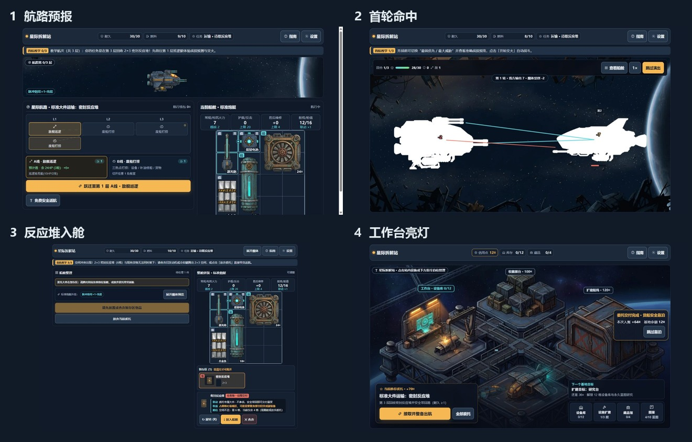

# 《星际拆解站》首航体验与改版建议

2026-11-24。分析对象为本地 `main` 的默认 V2，提交 `084e781` 及当前工作区。用 11 月 23 日交付的静态包从新档走完一次三层教学并靠泊。另用当前源码的战斗、装舱和结算函数对照不同决策，重跑 V2 平衡模拟。浏览器实走的是桌面首航。后期构筑、正式航线和高清屏数据的判断来自代码、规则模拟与项目已有诊断。以下改版与盲测门槛属于建议。

**优先把一件事做成玩家想重复的动作：在一艘装不下所有东西的小船上，亲手决定拆什么、带什么，然后看自己的船以不同方式完成下一站。** 项目已经有占格、旋转、相邻供能、敌人克制和返航卸货。当前首航把它们排成了几段相互脱节的操作。画面最壮观时玩家在看播片，需要动手时又退回两栏面板。

## 一趟首航教会了玩家什么

| 步骤 | 本次实际画面和操作 | 对体验的影响 |
| --- | --- | --- |
| 1. 进站 | 工作台、船坞、吊臂都有明确轮廓。初始余额为零，首屏同时出现研究台还差 100、船坞 120、展台 100，以及库存、藏品和图鉴入口。 | 这是很好的家园场景，但新玩家还没捡到过东西，先看见了一串缺少的东西。见[初始基地](01-base.jpg)。 |
| 2. 选首站 | 黄按钮已经选好巡逻艇。航路写明预计胜、3 轮、余 24 耐久和赏金 6。右侧是具体可辨的炮、电池和货物，航行阶段只可检查。 | 第一眼最想摸的物件暂时不能移动。路线本身成立，但节点按钮、路线比较卡和跃迁按钮连续表达同一个目的地。见[航路](02-route.jpg)。 |
| 3. 交火 | 船上有激光炮和电池，对面只有一艘巡逻艇。我切到“优先最大威胁”，结果仍是 3 轮、余 24。按开始后可以看船舱、变速或跳过。 | 战前画面提供了目标策略，此时两种策略等价。第一轮两船同时闪白，光束和伤害数清楚，装备材质在命中瞬间消失。见[战前](03-encounter.jpg)和[第一轮](04-combat.jpg)。 |
| 4. 领赏 | 战后实际剩 24 耐久。我选抢修回到 30，没拿物品，随后看到“已清空暂存区”和“整理完毕”。第二层抽油之后又出现同样的整理步骤。 | 在这条实际路线里，游戏两次让我确认一项没有发生的货物变更。奖励页还给电池预测“第 2 层标准敌舰”，教学后两层实际上都是废船。见[战后奖励](05-reward.jpg)、[空整理](06-arrange.jpg)和[废船](07-wreck.jpg)。 |
| 5. 装反应堆 | 第三层回收了一件占六格的货。已有十二格被占，玩家终于需要在物件之间作取舍。我卸掉旧引擎，保留冷却罐，装上反应堆。 | 这是整段教学里最贴题的时刻。操作提示已经点名“舍弃旧发动机或冷却罐”，最显眼的是不可用的离开按钮，待搬的大件在屏幕下部。见[空间冲突](08-reactor.jpg)。 |
| 6. 返航 | 入账 64，工作台亮灯，吊臂开始作业。随后推荐的正式委托仍是第三层回收密封反应堆，标价 70。 | 基地变化有记忆点。不过刚学完运输的玩家最先看见的是再运一次同样的货。见[入账](09-settlement.jpg)和[靠泊](10-return.jpg)。 |

## 玩法问题可以用两组实际结果解释

**第一组：玩家摆对了，首战却没有回报。** 教学预先把电池放在激光炮旁。舰核每轮 2，激光炮基础 3，供能后激光炮变成 5。我把同一块电池移到合法但不相邻的右下角，用同一场战斗重算。

| 首战状态 | 每轮总伤害 | 击破所需回合 | 战后耐久 |
| --- | ---: | ---: | ---: |
| 当前巡逻艇 15 HP，电池未连接 | 5 | 3 | 24 |
| 当前巡逻艇 15 HP，电池已连接 | 7 | 3 | 24 |
| 只在内存中把教学敌舰改成 14 HP，未连接 | 5 | 3 | 24 |
| 同一只 14 HP 教学敌舰，已连接 | 7 | 2 | 26 |

伤害增加在系统内完全生效，敌舰血量却恰好使两种摆法跨不过回合门槛。把一块电池作为首个可装零件，让玩家接线，再用专属教学敌舰展示少挨一轮齐射，已有规则就能承载一个有说服力的教学。14 HP 只是经过演算的一种候选值，适用于专属教学节点，不必改正式航路里的巡逻艇。[教学摆位](../../src/v2/data/tutorialV2.ts#L229) · [相邻电池](../../src/v2/domain/buildStatsV2.ts#L118) · [战斗预报](../../src/v2/domain/combatV2.ts#L343)

**第二组：最有趣的拼装题正好出在最后一站。** 固定首战拿抢修、后两站取燃料，以相同的待装反应堆为起点，每种方案只丢一件。表中第一行已在浏览器完成，其余三行用实际放置规则搜索合法摆法，再调用同一结算函数。四组都完成了委托，均为满耐久，包含同样的 6 赏金和 40 首航奖励。

| 舍弃一件 | 可卖货物 | 最终入账 | 这趟实际牺牲了什么 |
| --- | ---: | ---: | --- |
| 拾获的旧引擎 | 18 | 64 | 放弃 24 货款，原地腾出大块空间，操作最直接 |
| 拾获的冷却罐 | 24 | 70 | 放弃 18 货款，需要重排 |
| 借用的激光炮 | 42 | 88 | 拆掉主要火力，之后直接结算，损失的火力没有机会体现 |
| 借用的合金条 | 42 | 88 | 腾出两格，再重排余下物件，货款与火力都可保住 |

这里有一个值得保留的发现：玩家确实可以靠摆放技巧比照提示操作多赚 24。问题在于，卸炮与保炮在这里赚得一样多，因为之后已经没有危险。这道题教会玩家算终点售价，却没有充分教会玩家“我保住了这门炮，所以敢去下一站”。把大件移到倒数第二个节点，立刻提供安全返航与可选风险路线，让两种船各有去处。[初始货物和借用来源](../../src/v2/data/tutorialV2.ts#L229) · [终层自动进入结算](../../src/v2/domain/encounter.ts#L783) · [归还借用与出售](../../src/v2/domain/settlementV2.ts#L47)

**正式航线有深度，入口把它稀释了。** 重炮对付逐发减伤的装甲，无人机分散攻击多个小目标，护盾反击需要吸收伤害才体现价值。试航甚至已经准备好了三套完整组合。开篇却让玩家用一套摆好的炮打单目标，做完同类运输后才能在推荐路径上接近这些差异。首航回来可以直接看到一条等待救援的信号，或者用刚回收的设备试一次和运输完全不同的委托。正式局的可选深处则应提前露出具体收获，例如收藏馆里尚缺的导航仪，并把它和前方已知的危险放在一起；只增加层数或提高赏金很难让这次远航留下独特记忆。[敌人及克制](../../src/v2/data/enemies.ts#L53) · [三套试航](../../src/v2/data/trialBuilds.ts#L25) · [推荐委托顺序](../../src/v2/ui/V2AppController.ts#L550)

## 美术精度应花在哪里

**优先做一艘值得细看的炮艇、一个能动手拆的残骸、一个能认出收获的船坞。** 基地有很好的工业手绘底子，机构、箱体和吊臂在待机时都能读出来。首航返港工作台从冷暗变成暖亮，本次实拍看得出前后差异。这套“同一个地点因我而改变”的表达，值得用在另外两个主场景上。

- **炮艇与战斗。** 命中处理会把整艘舰体填成白色，首轮截图里双方都只剩剪影。已有炮位、后坐、光束、护盾和伤害事件可复用。建议把一次关键射击分成炮膛充能、炮座后坐、目标局部受击三拍，击在盾上出弧纹，打在装甲上出火星或剥落。低动效模式保留受击部位和形状差别。验收时静音、遮住伤害数，让人指出哪件设备开火、哪一侧中弹。代码已有这些表现的起点。[武器事件](../../src/v2/scenes/V2CombatScene.ts#L811) · [受击着色](../../src/v2/scenes/V2CombatScene.ts#L1097)
- **残骸与拆卸。** 实拍中的军械舱、货舱有剖面和暖光，中央“反应舱”标签却压在一片开口上，很难通过机械外形辨认。点击舱室后还须点底部按钮；代码在同一个点击回调中启动切割特效、结算并切换界面。建议先精制一处真实可辨的固定夹与剖切层，点夹具后露出零件，让同一形状的物件从残骸进入待装区。切割可以一键完成，保留点选、键盘操作与跳过长演出。漂亮的拆解图应当也承担操作。[舱室热区与确认](../../src/v2/ui/V2AppController.ts#L1598) · [切割与状态切换](../../src/v2/ui/V2AppController.ts#L1632)
- **基地与素材。** 工作台已有独立叠图、焊光和靠泊吊运。把镜头和暖光集中到这次回收真正影响的工位，给反应堆一个可辨的卸货、就位和通电过程，再告知解锁。单纯交付一张更大的背景无法表达这些状态。高清屏仍值得定点升级：当前基地底图是 1280×720，标准炮艇 512×256。历史诊断在 2× 屏上对应 1146 和 390 CSS 像素的展示宽度，源图横向分别仅约 1.12 和 1.31 倍，格内激光图标则约 2.29 倍。优先重制大幅主景和主舰的近景素材，以实际展示尺寸验收。[基地靠泊与卸货](../../src/scenes/BaseScene.ts#L664) · [高清屏诊断](../../docs/reviews/2026-11-21-v2-polish/asset_clarity_diagnostics.json)

## 怎样去掉工作台感

| 场景 | 让玩家直接操作 | 系统在背后完成 |
| --- | --- | --- |
| 航路 | 在星图上比较两个可达地点，看到对方舰型、可能拿到的货和自己的改装余地。一个确认动作承担跃迁承诺。 | 合并同目的地的节点和比较卡。详细战损推演可展开，继续使用实战模拟器，保留玩家规划所需的精度。只有一艘敌舰时省去集火策略切换。 |
| 废船 | 在残骸上指向要拆的部件，看见形状和大概用途，确认后它直接出现在舱口。 | 无实物、无待处理委托或换装机会时直接回航图，留下随时可用的“调整船舱”。发放任务物后再决定是否进整理页，以免吞掉同一节点发的反应堆。 |
| 船舱 | 屏幕主体是船舱和手里的零件。拖动或点选时显示所占轮廓、与炮的连接、将损失的货值。 | 自动处理摆放后的统计更新。把“推荐位置”、每格售价和推演细节放进二级帮助；提示要说清是前方真实敌人还是训练靶。缺色觉的玩家也能靠接口形状、连线和合法标记判断。 |
| 返港 | 看吊臂卸下刚才留住的那件货。遇到“出售还是留作研究／收藏”时才停下来选。 | 自动处理只有一种去向的借用件与交付件，账单可展开。现有计算器仍负责唯一一次入账、库存上限和战损，动画只呈现结果。 |

这里有两个实现细节会影响手感。其一，战术推荐会遍历合法位置和旋转，综合胜负、余血、回合、连线打分；无实际前路战斗时还会生成参考敌舰。它很适合可选的试验台，放在每个奖励的首层容易把“我发现了一种摆法”变成照提示放置。其二，界面刷新时会销毁并重新挂载船舱组件。可以先在新首航里让同一片船舱跨拾取、摆放与确认持续存在，选择与焦点也保留。是否有帧率问题需要单独测量，本次发现的是交互连续性与展示层耦合。[参考敌舰选择](../../src/v2/domain/tacticalDelta.ts#L53) · [推荐落点评分](../../src/v2/domain/tacticalDelta.ts#L127) · [船舱组件挂载](../../src/v2/ui/V2AppController.ts#L3608)

## 第一轮制作范围与判定标准

建议采用**小船打捞、船舱构筑、可选冒险**这个方向。它保留短局、单手点选和自动战斗，也能延续已写好的存档、结算与形状规则。若将主要技术预算投入自由飞行和手动射击，项目就会转向操作与反应速度，首要验证目标也随之改变。就现有题材、素材和实拍暴露的问题，首轮更值得验证的是玩家是否会喜欢自己的改装。

1. **先做一趟约五分钟的首航。** 用现有船和灰盒部件做一艘废船。开场可摸到电池，摆上一格后炮座实际通电；接一场摆法能相差一轮的战斗。随后遇到六格反应堆。保留原有允许安全返航的设计，给带足火力的玩家一条标明敌情与具体奖励的支线。回站让反应堆点亮工作台，下一单优先展示玩法不同的救援。玩家完整经历一次“亲手改船、改船救了我、收获改变基地”。
2. **在同一趟首航里做一次完整的美术精修。** 一艘船、一个炮位、一种敌人、一处残骸、一个卸货点，按屏幕实际尺寸统一比例、明暗和材质。卡扣、炮座、吊臂分别有落手和受力的反馈；同一件货在剖面、船舱、船坞可凭轮廓认出。用桌面和窄屏各走一遍，包括纯点选操作，再决定要不要扩展全部资产。
3. **用玩家行为决定是否扩产。** 先找约 8 名没玩过的新玩家做小样本观察，用旧版作为基线，两版分开招募或交叉平衡先后。预先约定方向性目标，例如至少 6 人无需提示能完成一次有后果的改装，并能说出下一战为什么不同；记录第一次有效操作的用时、纯确认次数、主动返航／冒险的理由，以及结束后是否自愿再开一局。记录玩家实际重开，不用“你觉得好玩吗”的回答代替。小样本用于找问题，无法估算长期留存。

本次重跑的九组策略各 40 个种子。三组标准委托均 40/40 完成，深入普通装备的三组为 72.5%–77.5%。这些脚本预先解锁设施和船员，并能直接读取生成器的保底路径，达到委托目标即按预定策略返航。它们适合保护规则可解、检查失败率与防止退化。判断首航能否吸引玩家继续，还需要上面的真实选择数据。[模拟初始条件与选路](../../tests/v2-simulation.test.ts#L146)
